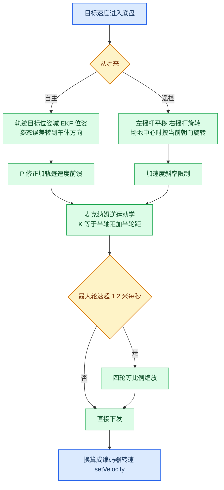
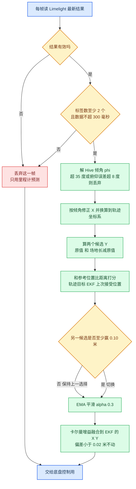
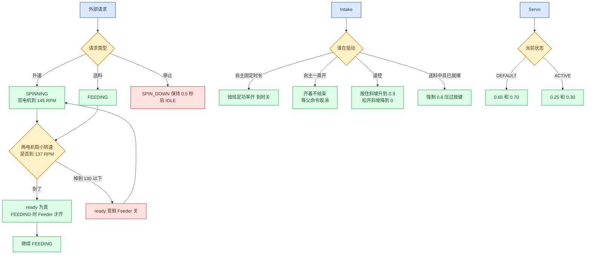
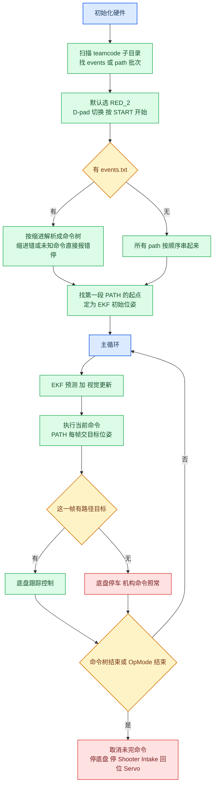
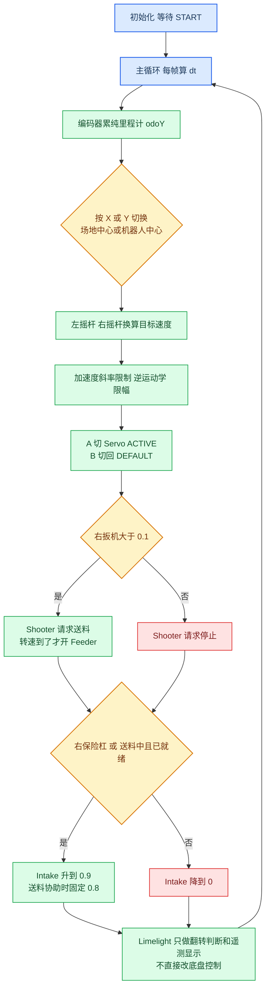

# KeystoneFTC-code

FTC 队伍 **#37502**（北京市鼎石学校高中部）机器人代码。

这套代码分五块：底盘、视觉定位、机构、自主、遥控。下面每块都有一张流程图，图里写的是代码实际在跑的逻辑。图下面再把几个关键判断说一遍。

参数都集中在 `teamcode/config/RobotConfig.java`，改参数只改那一个文件。

---

## 1. 底盘

四电机麦克纳姆底盘，`FL / FR / BL / BR` 四个 `DcMotorEx`。电机都设成 `RUN_USING_ENCODER`，用速度 PIDF 控。方向按装车顺序反了一个，代码里写死了。

核心就一步：给定车体三个方向的目标速度（前后、左右、转），用逆运动学算出四个轮子各自的速度。里面用的 `K = 半轴距 + 半轮距 = 0.365` 米。任何一个轮子算出来超过上限，就四个轮子一起按比例缩，不让某一个轮子单独饱和把方向带偏。最后把米每秒换成编码器转速下发。

自主和遥控最后都走到这一步，区别只在目标速度从哪来：



几个细节：

- 自主这边，P 增益是 `KP_X = 5、KP_Y = 5、KP_THETA = 3.5`。轨迹自带的速度和角速度做前馈，P 只补偏差，不靠 P 去追速度。
- 遥控这边，摇杆满量程对应 1.2 米每秒。转速按 `1.2 / K` 缩，四个方向的加速度都用斜率限制，限值 3.0 米每秒平方，就是说不让速度一下跳过去，起步和换向都缓一点。
- 遥控按 `X` 切场地中心，代码会把按下的那一刻的车头方向当作正前方基准。按 `Y` 切回机器人中心。不是按场地绝对方向对的，是按切换那一下的方向，评委看代码的时候注意这点。
- 里程计单独累：每帧读四个编码器增量，换成米，算出车体前后左右位移，再转到场地坐标累加。这个纯里程计值不吃视觉修正，后面视觉翻转判断要拿它当尺子。

---

## 2. 视觉与定位

定位是三样东西：编码器里程计 + IMU 朝向 + Limelight 3A 的 AprilTag 位姿。跑的是一个 EKF：每帧先用里程计和 IMU 做预测，再拿视觉结果做一次修正。视觉只修正 X、Y，朝向不融合视觉（`FUSE_VISION_THETA = false`），朝向一直靠 IMU。

Limelight 这一帧先过几道门，任何一道不过整帧丢掉，只靠里程计顶着走：



说一下为什么这么绕：

- **先解倾角。** Limelight 给的位姿默认 Hive 是平的，实际 Hive 会绕支点倾。代码拿 `x、z、yaw、pitch` 反解倾角 `phi`，支点高度 1.075 米，倾角上限 35 度。解出来还要反推一个俯仰角跟实测俯仰比，差超过 8 度就认为是脏数据，整帧不要。这个校验能挡掉不少姿态乱跳的帧。
- **Y 轴翻转。** 12 英尺场地，Limelight 的 Y 有镜像的可能，一个 Y 值对应两个候选：`原值` 和 `3.6576 - 原值`。代码不会硬选一个，两个都算，跟参考位置比距离，离谁近用谁。参考有三个：当前轨迹的目标 Y、EKF 自己的 Y、上一次接受的视觉 Y（越久权重衰减，1 秒时间常数）。遥控里没有轨迹目标，参考换成「上次接受位置 + 这段时间纯里程计走了多少」。
- **防抖。** 切换要带回差：上一帧选了 A，这一帧 B 得至少近 0.10 米才切过去。卡在场地中线附近的时候，不会两边来回跳。
- **融合。** 选出来的位置先过一层 EMA 平滑，再按卡尔曼增益（不确定度比上视觉噪声，信任系数 0.8）拉 EKF。偏差小于 0.02 米不动，避免原地抖。视觉断了超过 300 毫秒，EMA 直接清空，下次来了从头算，不拿陈旧值接着平滑。

遥测里把 `raw / flip` 两个分数和最后选了哪个都打出来了，场上出问题先看这几行。

---

## 3. 机构

机构分三块，各管各的，状态都写在各自子系统里。



- **Shooter。** 双电机速度 PIDF 控到 145 RPM。准备好"ready"用的是两电机里更慢的那个：到 137 RPM 算就绪，掉到 130 以下才算没就绪，中间这段维持原状态，就是个迟滞，不让转速在临界点附近反复开关。Feeder 只有在 `FEEDING` 且 ready 时才开 0.9，升速没到就只转不喂，料不会提前塞进去。停的时候走 `SPIN_DOWN`，再保持目标转速 0.5 秒才断电；比赛结束和 OpMode 退出用的是立即停，三个电机直接断。
- **Intake。** 自主里有两种：定时的（开 N 秒到时关，包括 `SHOOT` 期间的 0.8 送料协助），和一直开的（`INTAKE` 不带时长，`isFinished` 永远假，靠父命令 `RACE` 的胜者把它取消）。遥控里是斜坡：按住每秒升 1.0 到 0.9，松开降到 0；射击正在送料且已就绪时，强制 0.8，不管你按没按。
- **Servo。** 就两个位置，DEFAULT 和 ACTIVE，左舵机 `0.65 / 0.25`，右舵机 `0.70 / 0.30`。命令都是瞬时的，`start` 就到位。遥控里 `A` 切 ACTIVE，`B` 切回 DEFAULT，两个都是边沿触发，长按不重复触发；`B` 只在当前是 ACTIVE 时有效。

---

## 4. 自主

自主的活儿是：按 `events.txt` 这张脚本表把轨迹、射击、进料、舵机、视觉分支串起来跑。脚本是缩进敏感的文本，解析时缩进不一致、未知命令、缺参数都会直接抛错停掉，不带病开跑。



命令树四种组合，语义很直白：

| 关键字 | 意思 |
|---|---|
| `SEQ` | 一个接一个，前一个结束才启动下一个 |
| `PAR` | 几个一起跑，全部结束才算完 |
| `RACE` | 几个一起跑，先结束的赢，其余取消。`INTAKE`（一直开）就是靠这个收尾的 |
| `IF_VISION` | 见下面 |

叶子命令：`PATH` 跟轨迹，`WAIT` 等，`SHOOT` 射击，`INTAKE` 进料，`SERVO_ACTIVE / SERVO_DEFAULT` 切舵机。

`PATH` 的执行：轨迹是 `path_*.txt` 里带时间的采样点，代码按当前本地时间在相邻两点之间线性插值，每帧把插值出来的位姿、速度、角速度交给底盘。角度插值单独处理，按最短弧绕，不会跨过 ±π 跳一圈。

`IF_VISION` 的执行分两段：先在 `WAITING` 里每帧问视觉当前能看到哪些 Tag，有一个命中过滤（比如 `34-37`）立刻走 `THEN`；等超时还没命中就走 `ELSE`。`RED_2` 里给了 17 秒超时，脚本里不写超时默认 0.2 秒。选哪条分支，遥测里有 `Conditional` 一行能查到。

`SHOOT` 的执行分三段：先升速，等 ready 再送料，送料时长到了就停 Feeder，再等 Shooter 降到 IDLE 才算结束。没 ready 不会提前喂料，这跟遥控是一套逻辑。

开跑前有个细节：EKF 的初始位姿取的是命令树里第一段 `PATH` 的第一个点。`IF_VISION` 优先按 `THEN` 那条找，ELSE 那条只在 THEN 里没有 PATH 时用。车停的位置得对上实际会跑的那条路，起始位姿错了后面全错。

比赛结束或 OpMode 被停，收尾顺序固定：取消还没跑完的命令（机构会跟着关），底盘功率清零，Shooter 立即停，Intake 关，Servo 回 DEFAULT，Limelight 停止。不留带电的机构。

---

## 5. 遥控

遥控就是把手柄输入翻译成底盘和机构的动作，循环里每帧按固定顺序走一遍。定位那套翻转判断遥控里也跑，但只用来显示，不参与控制，车不会因为视觉跳变乱动。



按键对照（Gamepad 1）：

| 操作 | 按键 |
|---|---|
| 移动 | 左摇杆 |
| 旋转 | 右摇杆 X |
| 场地中心 / 机器人中心 | `X` / `Y` |
| Shooter 送料 | 右扳机 `RT`（> 0.1） |
| Intake 斜坡 | 右保险杠 `RB` |
| Servo 切 ACTIVE / 回 DEFAULT | `A` / `B` |

几个点：

- 右扳机是电平的：按住就一直请求送料，Shooter 先升速、到了 ready 才开 Feeder；松开就请求停止，走 0.5 秒降速再断。
- Intake 的斜坡和送料协助是同一套，遥控里送料中+已就绪会把 Intake 顶到 0.8，按键此时不起作用。
- `X / Y / A / B` 都是边沿触发，按住不重复触发。`X` 同时把当前朝向记为场地中心的前方基准。
- 遥测每帧打印：驱动模式、Shooter 两边 RPM 和 ready、Feeder、Intake、Servo 状态，还有 Limelight 的标签数、Tag ID、raw/flip 两个分数、选了哪个、odoY。调试看遥测就够。

---

## 目录结构

```text
teamcode/
├── RedAuto.java              # 自主入口 "Red Auto"
├── RedTeleop.java            # 遥控入口 "Red TeleOp"
├── config/
│   └── RobotConfig.java      # 硬件名、几何、PID、转速、视觉与 EKF 参数
├── subsystems/               # 机构子系统
│   ├── ShooterSubsystem.java
│   ├── IntakeSubsystem.java
│   └── ServoSubsystem.java
├── commands/                 # 自主命令系统
│   ├── AutoCommand.java
│   ├── CommandGroups.java    # SEQ / PAR / RACE
│   ├── CommandParser.java    # 解析 events.txt
│   ├── PathCommand.java
│   ├── ConditionalVision.java# IF_VISION
│   ├── TagFilter.java
│   ├── VisionSource.java
│   └── OtherCommands.java    # WAIT / SHOOT / INTAKE / SERVO
├── RED_1/                    # 路径批次：events.txt + path_01~04.txt
└── RED_2/                    # 路径批次（默认）
```

`RED_1`、`RED_2` 必须直接放在 `teamcode/` 下。`RedAuto` 在车上运行时扫描的就是 `teamcode` 目录的直属子文件夹，多套一层就找不到了。

## 硬件名

| 名称 | 用途 |
|---|---|
| `FL / FR / BL / BR` | 四个底盘电机 |
| `imu` | IMU，REV Hub，Logo 朝下 |
| `limelight-dolphin` | Limelight 3A，pipeline 0 |
| `ShooterRight / ShooterLeft` | Shooter 双电机 |
| `Feeder` | 送料电机 |
| `Intake` | 进料电机 |
| `LeftServo / RightServo` | 两个舵机 |

## 部署

1. 把 `teamcode/` 整个文件夹复制到 FTC SDK 的 TeamCode 模块：`.../java/src/org/firstinspires/ftc/teamcode/`（OnBot Java 是对应目录）。
2. 确认 `RED_1/`、`RED_2/` 在 `teamcode/` 直属子目录下。
3. 在 FTC App 里 Build 安装，运行 **Red Auto** 或 **Red TeleOp**。

## `events.txt` 速查

```text
SHOOT 3.0                 # 射击，参数是送料时长（秒）
PATH path_01              # 跟踪 path_01.txt
WAIT 3.0                  # 等待
INTAKE 3.0 / INTAKE       # 进料：带时长是定时，不带是开到被取消
SERVO_ACTIVE / SERVO_DEFAULT

SEQ / PAR / RACE          # 顺序 / 并行 / 竞速
IF_VISION 34-37 17.0      # 见到 34-37 任意一个走 THEN，超时走 ELSE
  THEN
    ...
  ELSE
    ...
```

`path_*.txt` 是 CSV，列依次是时间、位置、姿态、线速度、角速度、线加速度、角加速度、线加加速度、角加加速度。

---

## English (summary)

FTC Team **#37502**, Keystone Academy (Beijing). Java code for a 4-motor mecanum robot: Limelight 3A + odometry + EKF localization, dual-motor shooter, intake, dual servos, trajectory-based autonomous with a scriptable `events.txt`, and a gamepad TeleOp.

The five flowcharts above (in Chinese) describe the drive base, vision/localization, mechanisms, autonomous, and TeleOp. Key points in brief:

- **Drive**: mecanum inverse kinematics from commanded body velocities, proportional scaling when any wheel exceeds 1.2 m/s. Autonomous adds P-correction on top of trajectory feedforward; TeleOp adds stick scaling and an acceleration slew limit.
- **Localization**: encoder odometry + IMU prediction, vision correction gated by tag count, staleness, and a solved hive tilt. The field Y-mirror ambiguity is resolved by scoring both candidates against reference positions, with 0.10 m hysteresis to prevent flip-flopping.
- **Mechanisms**: shooter feeds only when the slower of the two motors reaches 137 RPM (ready latch drops below 130 RPM). Intake is timed/hold in autonomous and ramped in TeleOp, with an 0.8 fire-assist override. Servos have two fixed positions.
- **Autonomous**: `events.txt` parses into a `SEQ / PAR / RACE` command tree with `IF_VISION` branching. No `events.txt` means all `path_*.txt` files run in sequence.
- **TeleOp**: field/robot-centric toggle, shooter on right trigger, ramped intake on right bumper, servos on `A/B`. Vision runs for telemetry only.

Copy the whole `teamcode/` folder into the FTC SDK TeamCode module (`.../java/src/org/firstinspires/ftc/teamcode/`), keep `RED_1/` and `RED_2/` directly under `teamcode/`, build, and run **Red Auto** or **Red TeleOp**.
